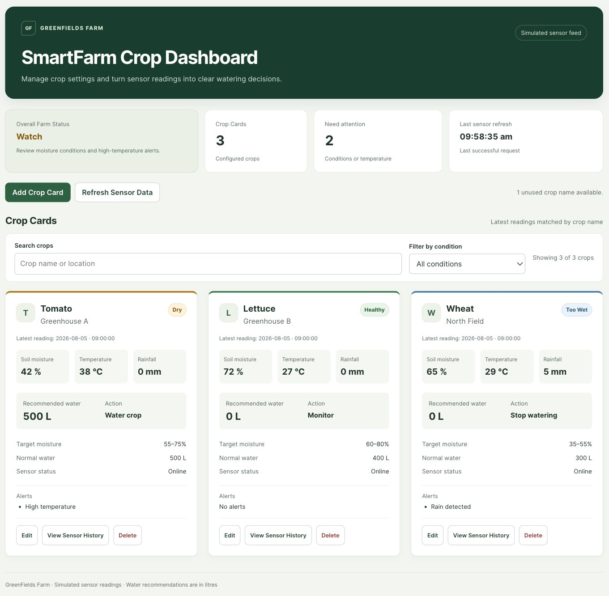
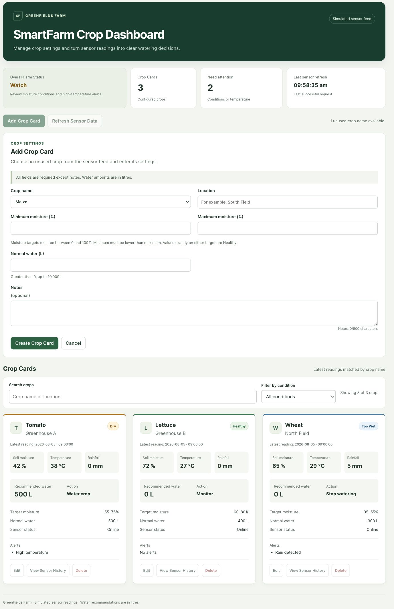
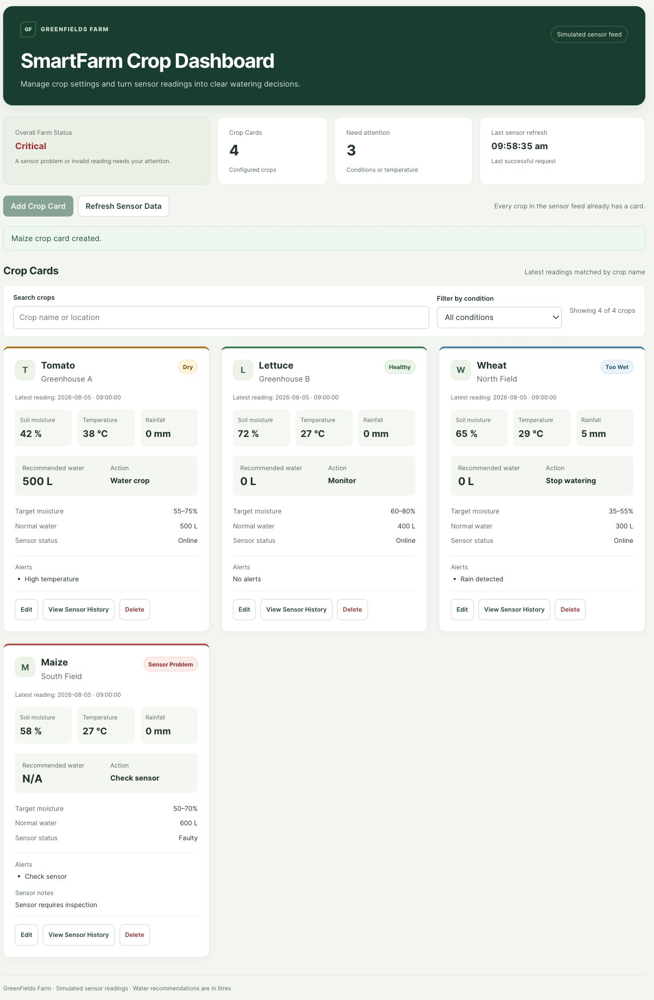
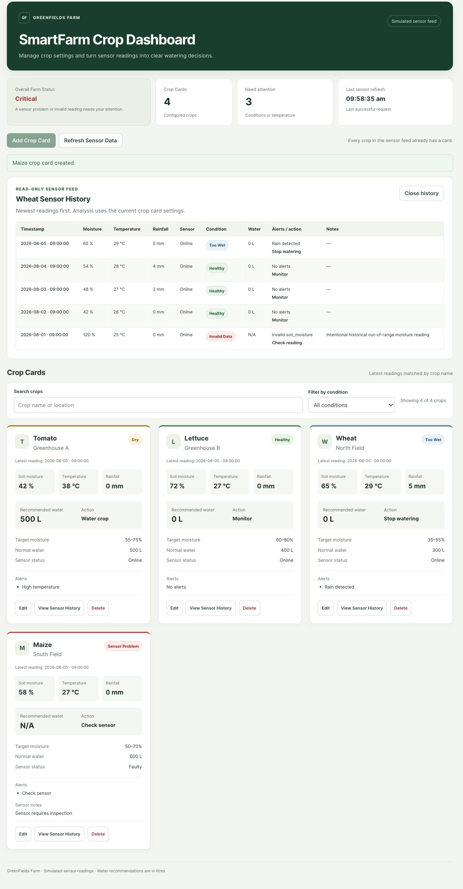
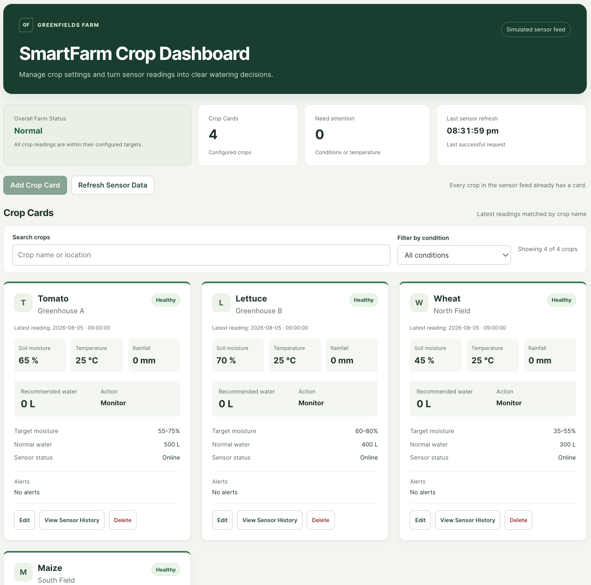
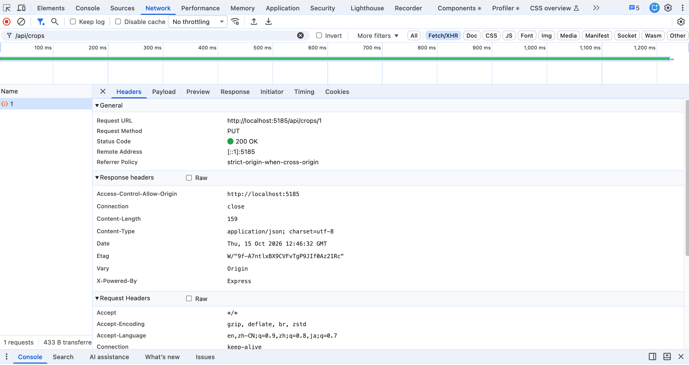

# GreenFields SmartFarm

**A crop management and simulated IoT sensor dashboard**<br>
Cloud-Based Web Application — academic project<br>
**Ruixin Huang · La Trobe University Student ID: 23025563**

GreenFields SmartFarm is a full-stack application for creating, viewing, editing and deleting Crop Cards. It combines crop settings stored in SQLite with a read-only JSON sensor feed to display moisture conditions, watering recommendations, alerts and Overall Farm Status. Sensor readings and recommendations are simulated for educational use.

## Video demonstration

A recorded demonstration of GreenFields SmartFarm is available through Google Drive:

[**Watch the GreenFields SmartFarm Video Demonstration**](https://drive.google.com/file/d/1c23kKyziS9GvXubNOEl53H2TONmH5nFq/view?usp=sharing)

The video shows the initial dashboard, creating Maize and matching its latest sensor reading, editing a crop, deleting and recreating Maize, refreshing the sensor feed, and viewing Wheat’s sensor history. It also explains the exact crop-name match and how the latest reading is selected by timestamp.

Upload the MP4 and source ZIP directly to the LMS. The Google Drive link is supplementary and does not replace the required MP4 upload.

## Application screenshots

The following figures were captured from the running application using the isolated review database and the submitted sensor feed.

### Crop dashboard

*Figure 1 — Three seeded Crop Cards, farm summary, latest readings and watering recommendations.*



### Create a Crop Card

*Figure 2 — Maize available in the Create dropdown, labelled fields and validation guidance.*



### Maize sensor result

*Figure 3 — Created Maize card with its latest Faulty reading, Sensor Problem, N/A water and Critical farm status.*



### Sensor History

*Figure 4 — Five Wheat readings, newest first, including the historical Invalid Data example.*



### Normal farm status

*Figure 5 — Normal farm status with zero crops needing attention.*



### Successful API update

*Figure 6 — Chrome DevTools shows a successful crop update.*



## Features

- Create Crop Cards using unused names from the valid sensor feed.
- Edit location, moisture targets, normal water amount and notes; keep crop names immutable.
- Delete and re-create cards without changing sensor readings.
- Match each card through exact, case-sensitive `crop_name` equality.
- Select the greatest timestamp independently of JSON array order.
- Calculate Dry, Healthy, Too Wet, Sensor Problem and Invalid Data results in React.
- Display recommended water, temperature/rain alerts, actions and Overall Farm Status.
- View all five matching readings in a read-only Sensor History table.
- Search crop names/locations and filter the visible cards by their latest computed condition.
- Refresh the sensor file and retain previous results if a later refresh fails.
- Provide loading, empty, validation, pending, success, error and Retry feedback.
- Support responsive cards and forms, text-labelled statuses, visible keyboard focus and a skip link.

## Technology stack

| Layer | Technology |
| --- | --- |
| Frontend | React, Vite, CSS |
| Backend | Node.js, Express |
| Database | SQLite through Node.js built-in `node:sqlite` |
| Sensor source | Read-only local JSON file |
| Automated checks | Node.js built-in test runner, native fetch, ESLint, Vite build |
| Browser checks | Chrome |

## Install and run locally

The project source code is available on GitHub: [**GreenFields SmartFarm repository**](https://github.com/23025563-latrobe/greenfields-smartfarm)

**Prerequisites:** Node.js and npm. The application was tested with Node.js 25.6.1; other Node.js versions have not been verified. Use two terminals, one for Express and one for React.

1. Extract the submitted source ZIP and open the included `greenfields-smartfarm` directory in a terminal. Git is not required to run the extracted application.

   If you are using a Git checkout instead, clone the repository and enter its directory:

   ```bash
   git clone https://github.com/23025563-latrobe/greenfields-smartfarm.git
   cd greenfields-smartfarm
   ```

   GitHub access is required if the repository is private.

2. Install and start the backend in terminal 1:

   ```bash
   cd backend
   npm ci
   npm start
   ```

   The API runs at **http://localhost:3101**. Open **http://localhost:3101/api/health** to check its health response. The API root `/` returns a JSON 404 because the backend does not serve the dashboard. For development with automatic backend restarts, use `npm run dev` instead of `npm start`.

3. Install and start the frontend in terminal 2, from the repository root:

   ```bash
   cd frontend
   npm ci
   npm run dev
   ```

   Open **http://localhost:5184**. Vite forwards `/api` requests to Express on port 3101, so **both applications must be running**. The frontend uses a strict port to prevent an unnoticed switch to a different URL.

### If a port is occupied

Leave unrelated projects running. Choose a free pair and update the proxy target together with the backend port. For example, in `backend/`:

```bash
PORT=3102 npm start
```

In `frontend/`:

```bash
API_PROXY_TARGET=http://localhost:3102 npm run dev -- --port 5185
```

Open http://localhost:5185 for this example. Ports 3102 and 5185 are also used by the optional isolated browser-test setup; do not run both configurations on the same ports.

### Run checks

From `backend/`:

```bash
npm test
```

From `frontend/`:

```bash
npm test
npm run lint
npm run build
```

The current automated suite contains **8 backend tests and 10 frontend tests**. Backend tests use in-memory or temporary SQLite databases and temporary sensor fixtures. They do not clear the working database or edit the submitted sensor file. One test deliberately removes a table from its in-memory database to verify the 500 error response; its expected server error is visible in the test output.

The README describes the main acceptance behaviour and test commands. The browser and automated checks noted here reflect the scenarios that were actually run.

## Database creation and initialisation

When Express starts, `backend/db.js` opens `backend/data/smartfarm.db`, creates the `crops` table if necessary and counts its records. It inserts the following cards **only when the table is empty**:

| Crop | Location | Target minimum | Target maximum | Normal water |
| --- | --- | ---: | ---: | ---: |
| Tomato | Greenhouse A | 55% | 75% | 500 L |
| Lettuce | Greenhouse B | 60% | 80% | 400 L |
| Wheat | North Field | 35% | 55% | 300 L |

Maize is deliberately not seeded. Create it through the UI using South Field, 50–70% and 600 L for the assignment demonstration.

SQLite generates `id` and `created_at`. Each record contains `crop_name`, `location`, `target_min`, `target_max`, `normal_water` and `notes`. Existing records persist across normal backend restarts without duplicate seeds. If all cards are deleted, the running dashboard shows No Crops; the next backend startup seeds the empty table again, as required.

No separate database server or manual SQL import is needed. Local database files are excluded from Git and the source ZIP. Do not delete the working database to run tests.

## Data ownership and sensor feed

| Data | Location | Responsibility |
| --- | --- | --- |
| Crop configuration | SQLite `crops` table | Express validates and performs CRUD |
| Sensor readings | `backend/data/sensor-readings.json` | Express rereads and structurally validates the file on every request |
| Conditions, water, alerts, actions and farm status | React | Calculated from current cards and readings |
| Last successful refresh time | React state | Updated only after a successful sensor request; reset on page reload |

The sensor file contains **20 readings: five each for Tomato, Lettuce, Wheat and Maize**, in mixed array order. Each object has exactly seven fields: `crop_name`, `timestamp`, `soil_moisture`, `temperature`, `rainfall`, `sensor_status` and `notes`. Timestamps are valid calendar date-times in `YYYY-MM-DDTHH:mm:ss` format, distinct within each crop.

Express returns raw readings, including one older, structurally valid Wheat reading with moisture 120. React labels that Online reading Invalid Data in Sensor History. A missing file, malformed JSON or structural error returns HTTP 500 with `{"error":"Sensor data file is invalid"}`. The application has no sensor-write endpoints and never stores derived results in SQLite.

## Matching and crop analysis

`crop_name` is the only join key. `Tomato` matches `Tomato`; it does not match `tomato`. For each card, React selects the matching reading with the greatest timestamp. The fixed timestamp format supports string comparison, so the latest reading need not be the final array entry.

The reusable helpers are in `frontend/src/utils/analysis.js`: `getAvailableCropNames`, `getLatestReading`, `analyseCrop` and `calculateFarmStatus`. Dashboard cards and Sensor History use the same `analyseCrop` function.

### Search and condition filter

The controls above Crop Cards combine a case-insensitive name/location search with an exact computed-condition filter. Search ignores leading/trailing spaces; this display search does not change the exact, case-sensitive sensor join. All conditions is the default. The live count shows how many cards match out of the total; a no-match view provides a reset control. A genuinely empty farm keeps its separate No Crops state.

These controls affect only the grid. Farm status, total cards, attention count and Create eligibility still use all configured crops. Search and condition selections persist through CRUD and refresh; open forms/history remain usable even if their cards stop matching. Failed refreshes preserve the previous filtered results and refresh time.

### Decision priority

Apply the following rows from top to bottom. The first matching main condition wins.

| Priority | Check | Condition | Recommended water | Action |
| --- | --- | --- | --- | --- |
| 1 | Sensor is Offline or Faulty | Sensor Problem | N/A | Check sensor |
| 2 | Online moisture outside 0–100, temperature outside 0–50°C, or rainfall outside 0–50 mm | Invalid Data; identify the field | N/A | Check reading |
| 3 | Moisture below target minimum | Dry | Card's normal water amount | Water crop |
| 4 | Moisture within the inclusive target range | Healthy | 0 L | Monitor |
| 5 | Moisture above target maximum | Too Wet | 0 L | Stop watering |

For valid Online readings only, temperature **above 35°C** adds High temperature, and rainfall **at least 5 mm** adds Rain detected. These alerts do not change recommended water. Moisture exactly at either target is Healthy; 35°C is not high; 5 mm triggers the rain alert. Sensor Problem takes priority even when a Faulty reading has an out-of-range number.

With the seeded settings, latest Tomato is Dry with high temperature and 500 L recommended; Lettuce is Healthy with 0 L; Wheat is Too Wet with rain and 0 L. Creating Maize displays its latest Faulty reading as Sensor Problem with N/A.

### Overall Farm Status

| Priority | Current dashboard | Status |
| --- | --- | --- |
| 1 | No Crop Cards | No Crops |
| 2 | Cards exist, but no sensor request has succeeded | Sensor Feed Unavailable |
| 3 | Any Sensor Problem or Invalid Data | Critical |
| 4 | Otherwise any Dry, Too Wet or High temperature | Watch |
| 5 | Otherwise | Normal |

Rain detected alone does not raise farm status.

### Loading, refresh and recalculation

Initial load requests both cards and readings and shows loading feedback. A failed card request shows an application error and Retry, with editable cards and forms blocked. A first sensor failure keeps loaded cards visible with N/A results, Never and Create disabled.

A successful refresh replaces readings, recalculates all results and updates the browser-time refresh value. A failed later refresh keeps the last successful readings, results, status and time, and shows an error banner. Successful CRUD updates the card state using the API response and recalculates against the current successful readings.

## API routes and error contract

| Method and route | Purpose | Success |
| --- | --- | --- |
| `GET /api/health` | API health check | 200 + object |
| `GET /api/crops` | Read all Crop Cards | 200 + array |
| `GET /api/crops/:id` | Read one Crop Card | 200 + object |
| `POST /api/crops` | Create a Crop Card | 201 + created object |
| `PUT /api/crops/:id` | Update allowed settings | 200 + updated object |
| `DELETE /api/crops/:id` | Delete configuration only | 200 + `{"deleted":true,"id":number}` |
| `GET /api/readings` | Reread and validate raw sensor data | 200 + array |

Failed responses use a JSON `error` key, for example:

```json
{"error":"crop_name already exists"}
```

Invalid fields, wrong types, names absent from the valid feed and changed crop names return **400**. Duplicate crop names return **409**; missing Crop Cards return **404**. Structural sensor errors and unexpected database/server errors return **500**. Unexpected errors return `{"error":"Internal server error"}` without exposing implementation details to the client.

## Input validation

| Field | Backend rule |
| --- | --- |
| `crop_name` | Exact name present in the valid sensor feed; unique; immutable after creation. PUT may omit it or send the unchanged name. |
| `location` | Non-blank string, at most 100 characters |
| `target_min` | JSON number from 0 to 100; less than `target_max` |
| `target_max` | JSON number from 0 to 100; greater than `target_min` |
| `normal_water` | JSON number greater than 0 and at most 10,000 L |
| `notes` | Optional string, at most 500 characters; omitted value becomes an empty string |

Numeric strings such as `"50"` are rejected. The React form provides guidance and feedback; Express independently enforces the rules before writing to SQLite. Pending requests disable relevant controls to prevent duplicate submissions.

## AI assistance and verification

I used OpenAI to help review the assignment, refine the interface, develop and debug tests, and check the documentation. I reviewed the resulting application and am responsible for understanding and explaining the submitted work.

### Sensor-data generation and review

I used OpenAI to help generate the sensor feed. The prompt I used for generating the dataset was:

> Create a JSON sensor feed for Tomato, Lettuce, Wheat and Maize, with five readings per crop. Include crop name, timestamp, soil moisture, temperature, rainfall and sensor status for each reading. Mix the records so the latest reading must be identified by timestamp. Include the required current cases and an older Wheat reading with 120% moisture to test invalid-data handling. Return valid JSON only.

I checked the submitted feed’s structure, crop coverage, timestamps and required latest and historical cases. The older Wheat reading is retained to show how the application handles invalid data.

### Problems found and corrected


- Loading environment variables in Vite initially caused an ESLint error because `process` was undefined. Importing it from `node:process` resolved the error; lint and build then passed.

Tests and API checks covered exact crop-name matching, uniqueness, latest-reading selection and duplicate feedback. Browser checks covered CRUD, persistence, history, refresh, sensor and crop-fetch failures, retry, the empty state and keyboard use. These checks used isolated test resources, preserving the working database and submitted sensor file.

### Implementation decision

The browser sends relative `/api` requests through Vite's development proxy. The backend port and proxy target can change together without editing React components. Separately, React stores raw source state and derives results through shared helpers, keeping cards, history and farm status consistent.

## Limitation

SmartFarm uses a static simulated feed. Refresh rereads the file but does not collect new measurements from physical hardware. Recommendations follow fixed assignment rules, not a field-calibrated irrigation model.

## Academic use and disclaimer

© 2026 Ruixin Huang · La Trobe University Student ID: 23025563. Developed for the Cloud-Based Web Application course. For educational and demonstration purposes only; simulated readings and watering recommendations are not operational agricultural advice.
